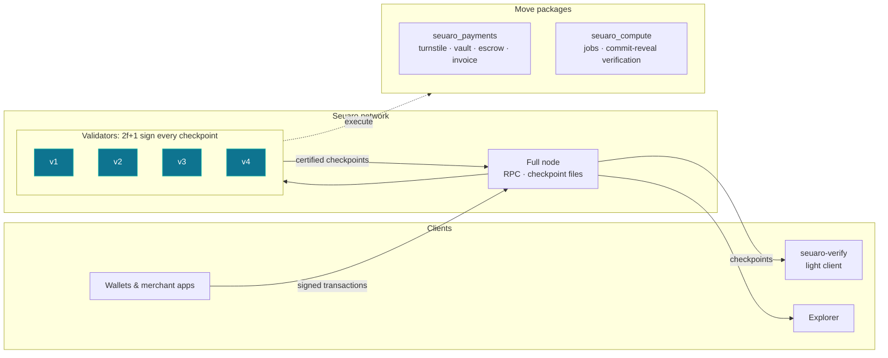

<div align="center">

<picture>
  <source media="(prefers-color-scheme: dark)" srcset="docs/assets/logo-dark.svg">
  
</picture>

### An independent Layer 1 for payments and verifiable compute, built only from proven components.

[](https://github.com/oddane/seuaro/actions/workflows/ci.yml)
[](LICENSE)
[](DISCLAIMER.md)
[](docs/operations/LAUNCH-GATES.md)
[](packages)
[](UPSTREAM.lock)

[**Run it**](RUNNING.md) · [**Architecture**](docs/ARCHITECTURE.md) · [**Design docs**](docs/README.md) · [**Security**](SECURITY.md) · [**Contributing**](CONTRIBUTING.md) · [**Roadmap**](ROADMAP.md)

</div>

> [!WARNING]
> Seuaro is **unaudited testnet software**. Testnet SEU has no value. There is no token sale, presale or airdrop. Read the [disclaimer](DISCLAIMER.md) before running anything.

---

## Overview

Seuaro is a payments-first blockchain with a settlement layer for AI compute. Instead of inventing a new protocol, it is assembled from components that have survived years of adversarial production use. Every one of them is recorded with its track record in a [proven-techniques register](docs/architecture/PROVEN-TECHNIQUES.md). It then adds what payment networks actually need: capped value pools, merchant escrow, invoices, and light-client finality checks that trust nothing but the genesis file.

| | |
|---|---|
| **Native coin** | Seuaro (SEU): fixed supply of 10,000,000,000, no perpetual inflation ([ADR-0002](docs/architecture/ADR-0002-native-asset-seu.md)) |
| **Consensus** | Mysticeti DAG-BFT with quorum-certified checkpoints, from a pinned open-source release ([UPSTREAM.lock](UPSTREAM.lock)) |
| **Execution** | Move VM with an object model and parallel execution |
| **Finality** | Deterministic; verified client-side by [`seuaro-verify`](tools/seuaro-verify) from genesis |
| **Fees** | Validator-surveyed reference gas price; users pay $0 through sponsored transactions ([ADR-0003](docs/architecture/ADR-0003-fees-and-sponsorship.md)) |
| **Decentralization** | Open validator admission with hard caps per operator, ASN, provider and region ([ADR-0004](docs/architecture/ADR-0004-validator-admission.md)) |

## Design principles

| Principle | In practice | Where |
|---|---|---|
| **Proven components only** | Every component is graded P0–P3; value paths use P3 only | [PROVEN-TECHNIQUES.md](docs/architecture/PROVEN-TECHNIQUES.md) |
| **Bounded blast radius** | Every value pool has a turnstile: outflow can never exceed inflow or a per-epoch cap | [`turnstile.move`](packages/seuaro_payments/sources/turnstile.move) |
| **Verify, don't trust** | Wallets check quorum certificates and committee hand-offs; an RPC answer alone is never "final" | [`seuaro-verify`](tools/seuaro-verify) |
| **Minimal, auditable fork** | Upstream changes only via numbered patches, branding only today | [FORK-DELTA.md](docs/architecture/FORK-DELTA.md) |
| **Learn from others' incidents** | Competitors' outages and exploits become regression tests and design rules | [COMPETITIVE-ANALYSIS.md](docs/strategy/COMPETITIVE-ANALYSIS.md) |

## Architecture



Detailed diagrams (transaction lifecycle, finality verification, genesis ceremony, contract state machines) are in [docs/ARCHITECTURE.md](docs/ARCHITECTURE.md).

## Quickstart

```bash
git clone https://github.com/oddane/seuaro && cd seuaro

# Option A: published image, no compiler needed (minutes)
scripts/quickstart.sh --image ghcr.io/oddane/seuaro-node:testnet

# Option B: build everything from source (30–90 minutes the first time)
scripts/quickstart.sh
```

This starts four validators (each generates its own keys in a multi-party genesis ceremony), a full node, a faucet, Prometheus, Grafana and the explorer, all on localhost:

| Explorer | RPC | Faucet | Grafana | Prometheus |
|---|---|---|---|---|
| `127.0.0.1:8080` | `127.0.0.1:9000` | `127.0.0.1:5003` | `127.0.0.1:3000` | `127.0.0.1:9090` |

Requirements, both paths in detail, and everyday commands: **[RUNNING.md](RUNNING.md)**.

## Repository map

```text
seuaro/
├── UPSTREAM.lock            Pinned upstream release, commit, toolchain, protocol version
├── patches/                 Numbered upstream patches (branding only), applied on every build
├── scripts/                 Build, devnet, container network, quickstart, reports
├── tools/seuaro-verify/     Light client: certificates, chain linkage, committee hand-offs
├── packages/
│   ├── seuaro_payments/     turnstile · vault · escrow · invoice (Move, with unit tests)
│   └── seuaro_compute/      Compute jobs with bonds and commit-reveal verification
├── docker/                  Node image, entrypoint, compose, monitoring
├── explorer/                Static block explorer
├── tests/                   Devnet acceptance, payments end-to-end, fault injection
└── docs/                    Architecture, ADRs, security, benchmarks, legal, strategy
```

## Verification

Each of these properties has an automated check that runs in [CI](.github/workflows/ci.yml).

| Invariant | What is checked | Test |
|---|---|---|
| CONS-01 · CONS-05 | Full chain verifies from genesis across committee hand-offs | `tests/phase1.sh`, `tests/phase2-faults.sh` |
| API-01 | A transaction is reported final only from certified checkpoints | `seuaro-verify tx`, tamper self-test |
| AUTH-01 | Checkpoints from another network's genesis are rejected | `tests/phase1.sh` |
| LEDGER-04 | Conflicting spends and replays move value exactly once | `tests/phase1.sh` |
| LEDGER-05 | Pools never pay out more than they received, or more than their epoch cap | Move unit tests (`vault_tests`) |
| PAY-01 · PAY-02 | Escrow and invoice payouts sum exactly; refunds are capped and go only to the payer | Move unit tests, `tests/payments-devnet.sh` |
| COMP-01 – COMP-04 | Compute payouts need the challenge window or a verifier quorum; votes cannot be copied | Move unit tests (`jobs_tests`) |
| LIVE-01 · CONS-04 | Live with 1 of 4 validators down; safe halt with 2 down; history intact after recovery | `tests/phase2-faults.sh` |
| DEC-01 | Voting-power concentration by operator, ASN, provider and region | `scripts/decentralization-report.py` |

All 32 invariants, with their required verification methods, are in [INVARIANTS.md](docs/security/INVARIANTS.md).

## Documentation

| Area | Documents |
|---|---|
| **Start here** | [RUNNING.md](RUNNING.md) · [Architecture](docs/ARCHITECTURE.md) · [Docs index](docs/README.md) |
| **Decisions** | [ADR-0001 core](docs/architecture/ADR-0001-core-choice.md) · [ADR-0002 SEU](docs/architecture/ADR-0002-native-asset-seu.md) · [ADR-0003 fees](docs/architecture/ADR-0003-fees-and-sponsorship.md) · [ADR-0004 validators](docs/architecture/ADR-0004-validator-admission.md) · [ADR-0008 feature set](docs/architecture/ADR-0008-protocol-feature-set.md) |
| **Security** | [Threat model](docs/security/THREAT-MODEL.md) · [Invariants](docs/security/INVARIANTS.md) · [Security policy](SECURITY.md) |
| **Operations** | [Launch gates](docs/operations/LAUNCH-GATES.md) · [Benchmarks](docs/benchmarks/MEASUREMENT-PROTOCOL.md) · [Delivery plan](docs/delivery/IMPLEMENTATION.md) |
| **Strategy** | [Competitive analysis](docs/strategy/COMPETITIVE-ANALYSIS.md) · [Roadmap](ROADMAP.md) · [Changelog](CHANGELOG.md) |
| **Legal** | [NOTICE](NOTICE) · [Trademarks](TRADEMARKS.md) · [Disclaimer](DISCLAIMER.md) · [License audit](docs/legal/LICENSE-AUDIT.md) · [Counsel checklist](docs/legal/COUNSEL-CHECKLIST.md) |

## Project status

| Phase | Scope | Status |
|---|---|---|
| 0 | Architecture, threat model, proven-techniques register | ✅ Done |
| 1 | Pinned build, own genesis, light client, devnet acceptance tests | 🔄 In CI |
| 2 | Container testnet, genesis ceremony, monitoring, fault injection | 🔄 In CI |
| 3 | Payment, invoice and compute contracts; gas station | 🔄 Contracts in CI · gas station planned |
| 4 | Audits, independent validators, 30-day soak, legal sign-off | ⏳ Not started |

Mainnet ships only when every [launch gate](docs/operations/LAUNCH-GATES.md) passes. See the [roadmap](ROADMAP.md).

## Contributing, security and support

- **Contributing:** read [CONTRIBUTING.md](CONTRIBUTING.md). Commits need a DCO sign-off; upstream changes go through `patches/` with two reviewers.
- **Security:** report vulnerabilities privately as described in [SECURITY.md](SECURITY.md). Please don't open public issues for them.
- **Conduct:** [CODE_OF_CONDUCT.md](CODE_OF_CONDUCT.md) · **Governance:** [GOVERNANCE.md](GOVERNANCE.md) · **Help:** [SUPPORT.md](SUPPORT.md)

## License and attribution

Licensed under the [Apache License 2.0](LICENSE). Seuaro builds on open-source code from the Sui project by Mysten Labs, Inc. (Apache-2.0), including the Move language originally developed by the Diem contributors; see [NOTICE](NOTICE) and the `THIRD-PARTY-LICENSES.md` generated with every build.

Seuaro is an independent project and is **not affiliated with, endorsed by, or sponsored by Mysten Labs or the Sui Foundation**. See [TRADEMARKS.md](TRADEMARKS.md).

<div align="center">
<sub>Seuaro · payments and verifiable compute · built in the open</sub>
</div>
