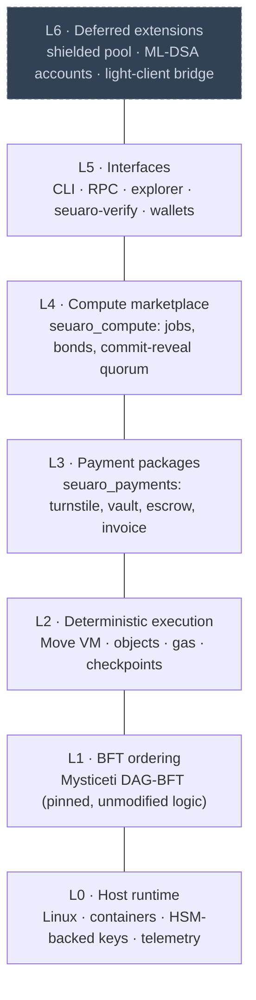
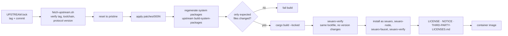
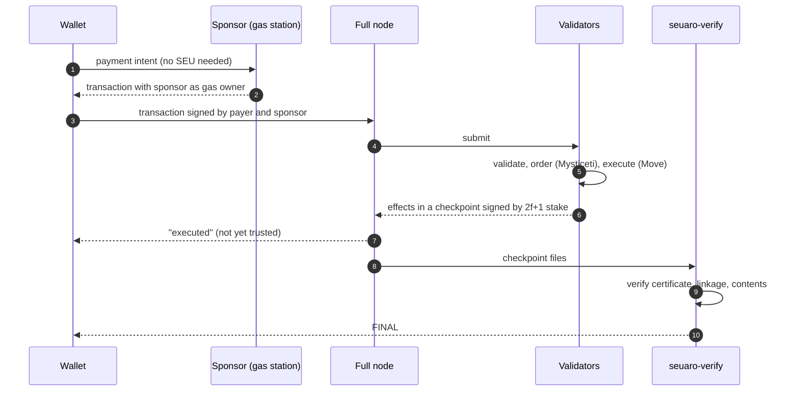
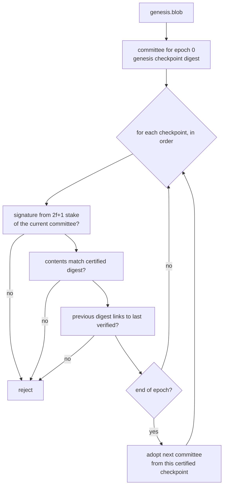
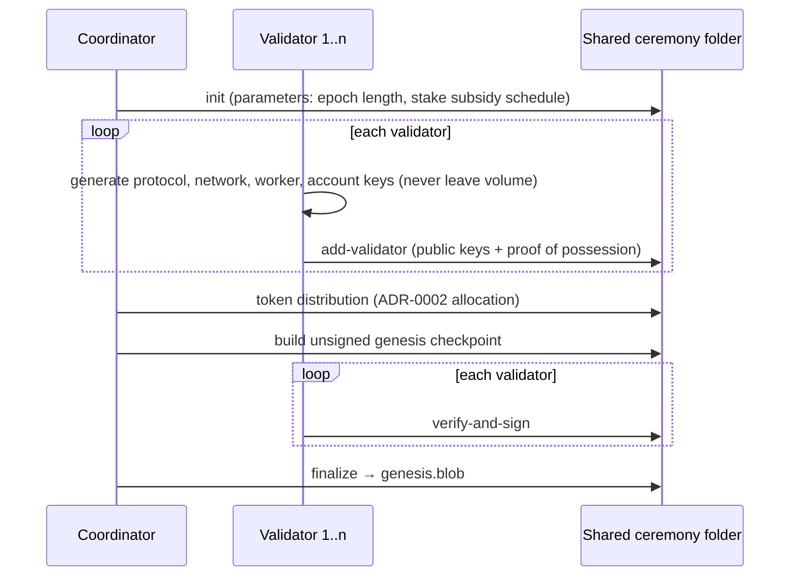
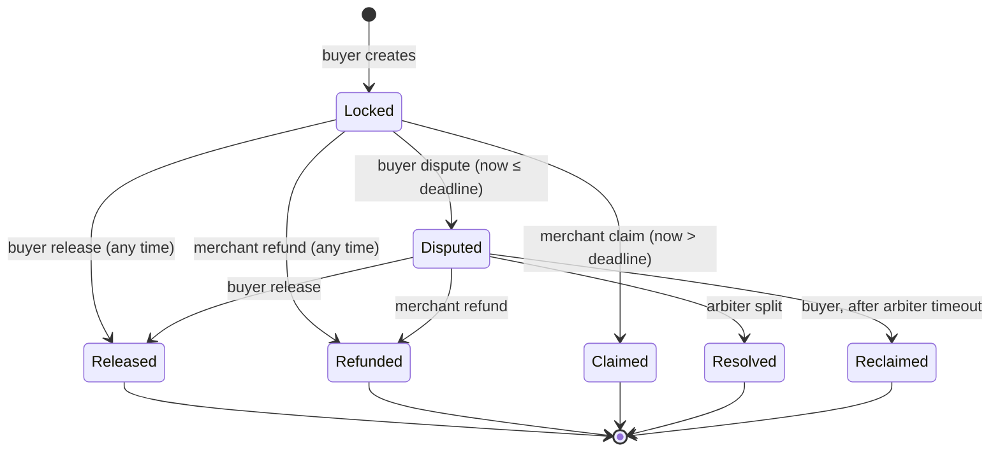
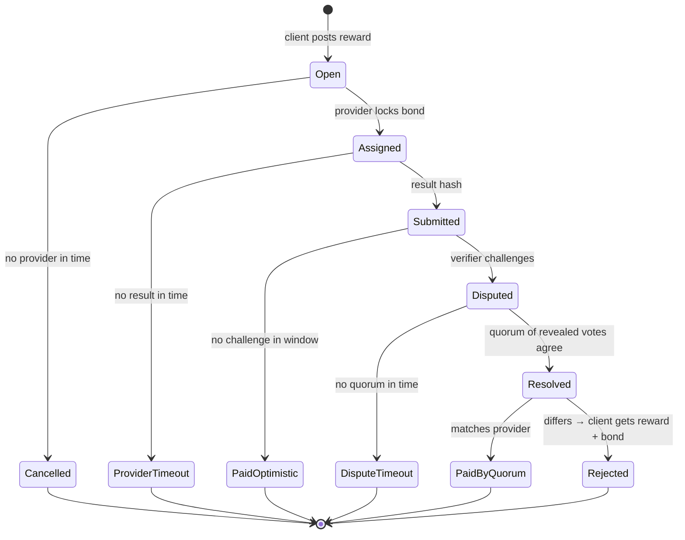
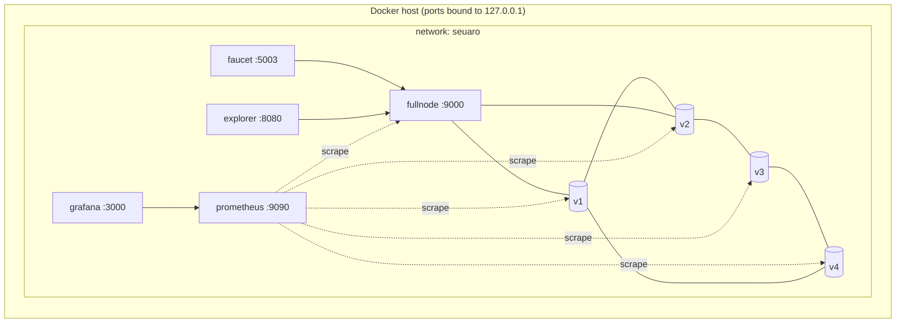

# Seuaro Architecture

This document explains how Seuaro is put together and how value moves through it. Design rationale lives in the [ADRs](architecture/); security properties in [INVARIANTS.md](security/INVARIANTS.md).

- [1. Layers](#1-layers)
- [2. Build and supply chain](#2-build-and-supply-chain)
- [3. Transaction lifecycle](#3-transaction-lifecycle)
- [4. Finality verification](#4-finality-verification)
- [5. Genesis ceremony](#5-genesis-ceremony)
- [6. Contracts](#6-contracts)
- [7. Deployment topology](#7-deployment-topology)
- [8. Failure behavior](#8-failure-behavior)

## 1. Layers

| Layer | Maturity (register) | Seuaro-specific code |
|---|---|---|
| L0 | P3 practices | `docker/`, `scripts/` |
| L1 | P3 | none (pinned upstream) |
| L2 | P3 | patch 0001: coin display metadata only |
| L3 | new (P0) Move code on P3 primitives | `packages/seuaro_payments` |
| L4 | new (P0) Move code on P3 patterns | `packages/seuaro_compute` |
| L5 | P3 + new verifier | `tools/seuaro-verify`, `explorer/` |
| L6 | P1–P2; testnet only | not built |

## 2. Build and supply chain

Guarantees: the upstream tag cannot silently move; nothing but the numbered patches changes upstream; dependency versions come from upstream's lockfile; every binary ships with its license notices.

## 3. Transaction lifecycle

## 4. Finality verification

`seuaro-verify` trusts only `genesis.blob`.

Built-in self-test: altered summary, swapped contents, withheld checkpoint, wrong committee and forged hand-off must all be rejected.

## 5. Genesis ceremony

Each validator generates and keeps its own keys. The shared ceremony folder only receives public information and signatures, following upstream's multi-party process.

## 6. Contracts

### Escrow (PAY-01)

### Compute job (COMP-01 – COMP-04)

Votes use commit-reveal: verifiers commit `blake2b(result ‖ salt ‖ address)` before anyone reveals, so votes can't be copied.

### Turnstile and vault (LEDGER-05)
Every pool records inflow and outflow. A withdrawal aborts if total outflow would exceed total inflow or if this epoch's outflow would exceed the cap. Cap cuts apply now; cap raises apply next epoch.

## 7. Deployment topology

Each validator has its own key volume and database volume. The full node writes every executed checkpoint to a volume that the verifier reads.

## 8. Failure behavior

| Situation | Behavior | Tested by |
|---|---|---|
| 1 of 4 validators down | Chain keeps finalizing | `phase2-faults.sh` F1 |
| 2 of 4 validators down | Chain halts at a fixed checkpoint; no fork | F2 |
| Validators return | Chain resumes; all earlier certificates still verify | F2 |
| One validator partitioned | Chain live; validator catches up after reconnecting | F3 |
| Restarts across epoch changes | Chain live; validator in sync | F4 |
| Tampered or foreign checkpoints | Rejected by the light client | `seuaro-verify self-test`, AUTH-01 |
